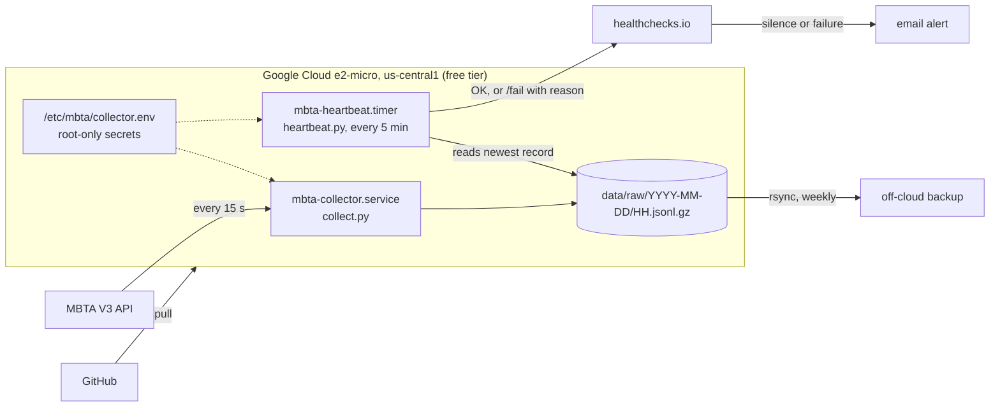

# MBTA Transit Reliability

Continuous collection of Boston MBTA subway and light-rail vehicle positions, every 15 seconds, around the clock, as the foundation for measuring how reliably the system actually runs: headways, dwell times, on-time performance, and how all three change through a Boston winter.

**Status, 22 November 2026:** 85,700 polls since 8 November with 0 failed polls and no gap longer than 90 seconds, about 5.5 million vehicle records, running at $0/month on Google Cloud's free tier.

## Why this exists

The MBTA's V3 API reports where every train is *right now*. It keeps no history. Questions like "how often do Red Line trains bunch at rush hour?" or "how much longer do trains dwell at platforms when it snows?" need that history, so this project records it: every snapshot, unmodified, continuously since November 2026.

## Architecture



## Design decisions

- **Store raw, parse later.** Each API response is appended unmodified to an hourly gzipped JSON Lines file. Any parsing mistake can be fixed by re-running the parser; a mistake baked into stored data cannot.
- **Failures are data too.** A failed poll is written as a record with `"ok": false` and the error, so gaps in the dataset are explicit rather than silent.
- **Health means fresh data, not a live process.** The heartbeat reads the newest record and reports healthy only if the last poll is under 5 minutes old, succeeded, and at least 2 GB of disk remains. A process can be "running" while every poll fails; this check catches that. Failures alert immediately; silence (server down) alerts after 15 minutes.
- **Least privilege.** The collector runs as a dedicated system user, `mbta`, that can write its data folder but not modify its own code. Secrets live in a root-only file (`600`) that systemd reads and passes in; the collector receives the key but cannot read the file.
- **Recovery is tested, not assumed.** The collector was killed with `SIGKILL` and was back in 11 seconds (`Restart=always`); the server was rebooted and the collector started on its own (`enable`).
- **Free by design, verified on the bill.** e2-micro, 30 GB standard persistent disk, us-central1: all within the always-free tier, confirmed against actual billing rather than the console estimate.
- **Backups never shrink.** The off-cloud backup uses `rsync` without `--delete`, so a loss on the server can never propagate to the copy.

## Repository layout

| Path | Purpose |
| --- | --- |
| `collect.py` | Polls the API and appends each response to hourly `.jsonl.gz` files. Never crashes on network errors; backs off when the API struggles. |
| `heartbeat.py` | Checks freshness, success and disk space of the latest data; reports to healthchecks.io. `--dry-run` prints the verdict without reporting. |
| `peek.py` | Summarises collected data: polls, failures, vehicle counts, statuses, routes, and every gap over 90 seconds. |
| `deploy/mbta-collector.service` | systemd unit for the collector. |
| `deploy/mbta-heartbeat.service`, `deploy/mbta-heartbeat.timer` | systemd unit and 5-minute timer for the heartbeat. |
| `deploy/collector.env.example` | Template for the server's secrets file. Placeholders only. |

## Data format

One JSON object per line, one file per hour (UTC):

```
data/raw/2026-11-08/01.jsonl.gz
```

```json
{"fetched_at": "2026-11-08T01:31:09.821+00:00", "ok": true, "vehicles": [ ... ]}
{"fetched_at": "2026-11-08T01:31:24.903+00:00", "ok": false, "error": "http_429"}
```

`vehicles` holds the API's vehicle objects unchanged, including `current_status` (`STOPPED_AT`, `INCOMING_AT`, `IN_TRANSIT_TO`), stop, trip, route, direction and `updated_at`. Route types 0 and 1: Red, Orange, Blue, Green (B, C, D, E) and Mattapan.

Growth is about 23 MB per day compressed.

## Configuration

| Variable | Used by | Default | Meaning |
| --- | --- | --- | --- |
| `MBTA_API_KEY` | collector | none | Free key from api-v3.mbta.com. Without it, requests are rate-limited heavily. |
| `MBTA_DATA_DIR` | all three scripts | `data/raw` | Where data is written and read. |
| `MBTA_POLL_SECONDS` | collector | `15` | Seconds between polls. |
| `MBTA_ROUTE_TYPES` | collector | `0,1` | GTFS route types to collect. |
| `HC_PING_URL` | heartbeat | none | healthchecks.io ping URL. Treat as a secret. |

## Running it

Locally:

```
export MBTA_API_KEY=your-key
python3 collect.py               # Ctrl + C to stop
python3 peek.py                  # summarise what was collected
python3 heartbeat.py --dry-run   # health verdict, no reporting
```

On a Debian server:

```
sudo git clone https://github.com/NavaneethMaruthi/mbta-transit-reliability.git /opt/mbta
sudo adduser --system --group --home /opt/mbta mbta
sudo mkdir -p /opt/mbta/data && sudo chown mbta:mbta /opt/mbta/data
sudo install -d /etc/mbta
sudo install -m 600 /opt/mbta/deploy/collector.env.example /etc/mbta/collector.env
sudo nano /etc/mbta/collector.env    # replace the placeholders with real values
sudo cp /opt/mbta/deploy/mbta-* /etc/systemd/system/
sudo systemctl daemon-reload
sudo systemctl enable --now mbta-collector mbta-heartbeat.timer
```

Requires only Python 3 standard library: no dependencies to install.

## Roadmap

- **Data contracts:** schema validation at ingest, with a quarantine path for records that break it.
- **Transformation:** Airflow orchestration and dbt models turning raw snapshots into arrival events, headways and dwell times.
- **Analysis:** on-time performance by line and hour, bunching, and the effect of winter weather.

## Data source

Vehicle data comes from the MBTA V3 API. Use of the data is subject to the MBTA's terms for developers.